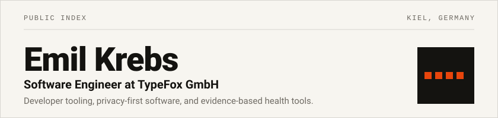

## 01 · Enterprise

Domain-specific tooling in the enterprise ecosystem at **[TypeFox GmbH](https://typefox.io/)** (Kiel): VSCode-Extensions, language servers, Langium-based DSLs, and Theia-based IDE platforms, plus open-source contributions to Theia and Langium. Enterprise engagements are under NDA.

## 02 · Live products

<table>
<tr>
<td width="120" align="center" valign="middle"></td>
<td valign="middle">
<strong><a href="https://vailnote.com">VailNote</a></strong> 
Privacy-first note &amp; secret sharing, zero-knowledge by design. 
<a href="https://vailnote.com">site ↗</a> · <a href="https://github.com/emilkrebs/VailNote">source ↗</a>
</td>
</tr>
<tr>
<td width="120" align="center" valign="middle"></td>
<td valign="middle">
<strong><a href="https://github.com/emilkrebs/med-research-mcp">med-research-mcp</a></strong> 
Evidence-graded literature search for AI agents: an MCP server for PubMed, Europe PMC, ChinaXiv and RussiaRxiv that ranks results by study design and flags retractions, preprints and animal-only studies. 
<a href="https://www.npmjs.com/package/med-research-mcp">npm ↗</a> · <a href="https://github.com/emilkrebs/med-research-mcp">source ↗</a>
</td>
</tr>
<tr>
<td width="120" align="center" valign="middle"></td>
<td valign="middle">
<strong><a href="https://emilkrebs.dev">emilkrebs.dev</a></strong> 
Personal site, set like a printed language specification. 
<a href="https://emilkrebs.dev">site ↗</a> · <a href="https://github.com/emilkrebs/emilkrebs.dev">source ↗</a>
</td>
</tr>
</table>

## 03 · In development

<table>
<tr>
<td width="120" align="center" valign="middle"></td>
<td valign="middle">
<strong><a href="https://emilkrebs.dev/#projects">Prami</a></strong> 
Active recall &amp; spaced repetition, engineered so the review schedule fades into the background.
</td>
</tr>
<tr>
<td width="120" align="center" valign="middle"></td>
<td valign="middle">
<strong><a href="https://emilkrebs.dev/healthstack">Healthstack</a></strong> 
A specialized IDE for lifestyle optimization on Eclipse Theia: biomarker tracking, unit conversion, purpose-built DSL.
</td>
</tr>
</table>

## 04 · Archive

[Generator-Discord](https://github.com/emilkrebs/Generator-Discord), Discord bot scaffolder on [npm](https://npmjs.com/package/generator-discord) · Spigot plugins · Discord bots (2022–2024, archived).

[WatchLock](https://github.com/emilkrebs/WatchLock) — lock your phone from your watch (Android + Wear OS). Play Store listing no longer live; source stays up.

## 05 · Index

<a href="https://emilkrebs.dev"> emilkrebs.dev</a>&nbsp;&nbsp;&nbsp;
<a href="https://github.com/emilkrebs"> GitHub</a>&nbsp;&nbsp;&nbsp;
<a href="https://www.linkedin.com/in/emilkrebs/"> LinkedIn</a>&nbsp;&nbsp;&nbsp;
<a href="https://medium.com/@emilkrebs"> Medium</a>

